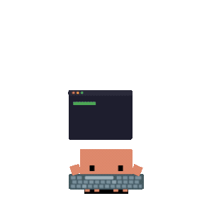

  

<h1 align="center">Dang Trang Thanh Su</h1>

  <strong>Backend Developer Intern · Java / Spring Boot</strong>

  

  
  
  
  

## About Me

<table align="center">
  <tr>
    <td valign="middle">
      Third-year Software Engineering student at FPT University, Ho Chi Minh City. I build backend services in Java and Spring Boot: REST APIs, JWT authentication, SQL databases and the tests around them. I've also shipped full-stack TypeScript apps with a team, including payments and role-based screens.
    </td>
    <td width="200" align="center" valign="middle">
      
    </td>
  </tr>
</table>

<table align="center">
  <tr>
    <td width="33%" valign="top">
      <strong>Short-term goal</strong>  
      Work on a real product as a backend intern, learn how a team works and get code reviews from senior developers.
    </td>
    <td width="33%" valign="top">
      <strong>Long-term goal</strong>  
      Become a full-stack developer with a strong backend.
    </td>
    <td width="33%" valign="top">
      <strong>Looking for</strong>  
      A Java / Spring Boot backend internship in Ho Chi Minh City.
    </td>
  </tr>
</table>

## Tech Stack

**Languages**

  &nbsp;
  &nbsp;
  &nbsp;
  &nbsp;
  &nbsp;

**Backend**

  &nbsp;
  &nbsp;
  &nbsp;
  &nbsp;
  &nbsp;
  &nbsp;

**Database**

  &nbsp;
  &nbsp;
  &nbsp;
  &nbsp;

**Frontend**

  &nbsp;
  &nbsp;
  &nbsp;
  &nbsp;
  &nbsp;
  &nbsp;

**Testing & Tools**

  &nbsp;
  &nbsp;
  &nbsp;
  &nbsp;
  &nbsp;
  &nbsp;

## Projects

<table>
  <tr>
    <td width="100%" valign="top">
      <strong><a href="https://github.com/thanhsu263/smart-teach-vn">SmartTeach – Classes and Quizzes for Teachers</a></strong> &nbsp; 
      Solo project · 11/2026 – now  
      <code>Java 26</code> <code>Spring Boot 4</code> <code>Spring Security (JWT)</code> <code>Spring Data JPA</code> <code>SQL Server</code> <code>Flyway</code> <code>React</code> <code>Testcontainers</code> <code>GitHub Actions</code>
      <ul>
        <li>Web app for Vietnamese high-school teachers to manage classes, build quizzes and give assignments that students open with a personal access code.</li>
        <li>JWT login with rotating refresh tokens in an HttpOnly cookie; a reused refresh token is detected and rejected.</li>
        <li>Classes and students API: every query is scoped to the owning teacher, and access codes are stored only as hashes.</li>
        <li>Integration tests run against a real SQL Server in Testcontainers; CI builds the backend and frontend on every push.</li>
      </ul>
      Java rebuild of my earlier TypeScript version, still live at <a href="https://smartteachvn.vercel.app">smartteachvn.vercel.app</a>.
    </td>
  </tr>
  <tr>
    <td width="100%" valign="top">
      <strong><a href="https://github.com/thanhsu263/sport-center-management-system">Arena3 – Sports Centre Management System</a></strong> 
      <a href="https://www.lelongsport.online">Live demo</a> · Full-stack developer (backend focus), team of 5 · 09/2026 – 11/2026  
      <code>TypeScript</code> <code>TanStack Start (React)</code> <code>PostgreSQL</code> <code>payOS</code> <code>Swagger</code>
      <ul>
        <li>Web app for courts, classes, packages, payments and reports, with screens for 4 user roles.</li>
        <li>Built the cashier module (API and screens): shift open and close, cash and bank transfer payments, cash mismatch alerts.</li>
        <li>Integrated payOS with an idempotent webhook to avoid duplicate payments; added VAT invoices and refunds.</li>
        <li>Took over the attendance and training flow: QR check-in, attendance sheets and absence tracking.</li>
        <li>Wrote unit tests for payment and refund logic, plus API test scripts for the cashier and report endpoints.</li>
      </ul>
    </td>
  </tr>
  <tr>
    <td width="100%" valign="top">
      <strong><a href="https://github.com/thanhsu263/rmit_hackathon_2026">Custodian Vault – Heritage Site Location Sharing</a></strong> 
      RMIT Hackathon 2026 · Team leader, team of 4 · 10/2026  
      <code>Next.js</code> <code>TypeScript</code> <code>Node.js</code> <code>TideCloak</code>
      <ul>
        <li>Keeps the exact locations of heritage sites hidden until stewards approve a request.</li>
        <li>2-of-3 steward approval flow with an audit log on TideCloak (demo in simulation mode).</li>
        <li>Led the team from idea to demo: set the scope, split the tasks and delivered the demo video on time.</li>
      </ul>
    </td>
  </tr>
</table>

## Education & Certifications

<table align="center">
  <tr>
    <td width="50%" valign="top">
      <strong>FPT University, Ho Chi Minh City</strong>  
      Software Engineering · 09/2024 – now
    </td>
    <td width="50%" valign="top">
      <strong>Certifications</strong>  
      CCNA: Introduction to Networks – Cisco Networking Academy (11/2025) 
      Microsoft Office Specialist Associate 2019 (08/2024)
    </td>
  </tr>
  <tr>
    <td colspan="2" valign="top">
      <strong>Competitions</strong>  
      RMIT Hackathon 2026 – Team leader (10/2026) · F-Talent Code 2025 – Participant (10/2025)
    </td>
  </tr>
</table>

## GitHub Activity

  <picture>
    <source media="(prefers-color-scheme: dark)" srcset="https://streak-stats.demolab.com?user=thanhsu263&hide_border=true&background=00000000&stroke=334155&ring=f59e0b&fire=f59e0b&currStreakNum=f8fafc&sideNums=f8fafc&currStreakLabel=60a5fa&sideLabels=94a3b8&dates=64748b" />
    <source media="(prefers-color-scheme: light)" srcset="https://streak-stats.demolab.com?user=thanhsu263&hide_border=true&background=00000000&stroke=cbd5e1&ring=f59e0b&fire=f59e0b&currStreakNum=0f172a&sideNums=0f172a&currStreakLabel=1d4ed8&sideLabels=475569&dates=64748b" />
    
  </picture>

  <picture>
    <source media="(prefers-color-scheme: dark)" srcset="https://github-readme-stats.vercel.app/api?username=thanhsu263&show_icons=true&hide_rank=true&hide_border=true&count_private=true&bg_color=00000000&title_color=60a5fa&text_color=e5e7eb&icon_color=60a5fa&ring_color=60a5fa" />
    <source media="(prefers-color-scheme: light)" srcset="https://github-readme-stats.vercel.app/api?username=thanhsu263&show_icons=true&hide_rank=true&hide_border=true&count_private=true&bg_color=00000000&title_color=1d4ed8&text_color=0f172a&icon_color=1d4ed8&ring_color=1d4ed8" />
    
  </picture>

  <picture>
    <source media="(prefers-color-scheme: dark)" srcset="https://raw.githubusercontent.com/thanhsu263/thanhsu263/output/pacman-contribution-graph-dark.svg">
    <source media="(prefers-color-scheme: light)" srcset="https://raw.githubusercontent.com/thanhsu263/thanhsu263/output/pacman-contribution-graph.svg">
    
  </picture>

## Connect

Open to Java / Spring Boot backend internships in Ho Chi Minh City. Email is the best way to reach me.

  
  

  

